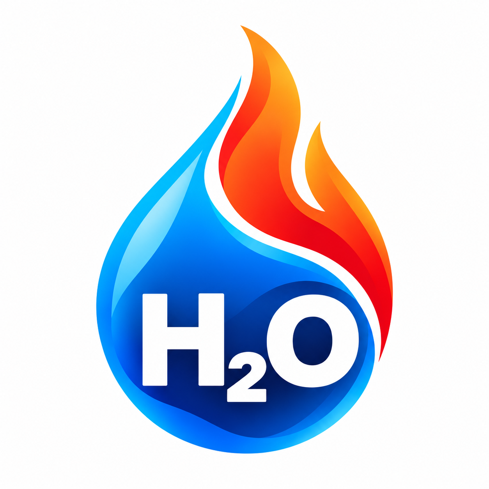

> Aktueller Bedienweg (29.10.2026): Persönliche Handyzugänge ausschließlich unter
> Verwaltung → H₂O Portal einrichten und wiederherstellen. Die gemeinsame technische
> Verbindung liegt ebenfalls dort. Getränke → Konto verwaltet nur die freiwillige iPad-PIN.
> Sicherungen und Zurücksetzen liegen unter Verwaltung → Getränke → Sichern & Zurücksetzen.
> Die folgende Dokumentation beschreibt ältere technische Betriebswege für bestehende
> Links; sie ist keine Anleitung zur Neueinrichtung.

# H₂O Portal – Benutzeranleitung

Stand: 16. Oktober 2026. Diese Anleitung beschreibt den vorhandenen zentralen
Cloudflare-Betrieb. Die Hilfe ist auch direkt in der Haupt-App unter **Hilfe**
und im Handy-Portal unter **Hilfe zum H₂O Portal** erreichbar.

## Persönlichen Zugang öffnen

Die Verwaltung öffnet **Einstellungen → H₂O Portal**, wählt das Mitglied und
zeigt dessen persönlichen QR-Code. Diesen mit dem eigenen Handy scannen.
Eine Microsoft-Anmeldung auf dem Handy ist nicht erforderlich. Der komplette
Link ist eine Zugangsberechtigung: nicht weitergeben, nicht öffentlich ablegen.
Bei Verlust oder Weitergabe die Verwaltung um Erneuerung des Zugangs bitten.
Bereits gelesene Informationen lassen sich dadurch nicht zurückrufen.

Über die Installationsanleitung **Auf dem Home-Bildschirm speichern** kann das
Portal wie eine App geöffnet werden. Auf iPhone/iPad ist dies für Push-Mitteilungen
nötig. Ein bereits vorhandenes Symbol kann nach einer Logoänderung noch das alte
Bild zeigen; gegebenenfalls erneut hinzufügen.

## Termine und Rückmeldungen

1. **Termine** öffnen. Angezeigt werden freigegebene Proben und die für dich
   bestimmten Sonderproben. Geburtstage erscheinen nicht als Probetermine.
2. **Bin dabei** oder **Entschuldigt** wählen. **Zurücknehmen** setzt die Antwort
   wieder auf offen. Änderungen sind bis zum Beginn möglich.
3. Die Speicherung abwarten. Bei unklarer Antwort **Speicherung erneut prüfen**
   verwenden. Eine offline angezeigte Auswahl gilt nicht als gespeichert.
4. **Kalender aktualisieren** lädt den Stand erneut. Bei Fehlern den Zeitstempel
   beachten. Ein offenes Portal aktualisiert sich etwa jede Minute; die
   Kalenderquelle kann zusätzliche Verzögerungen haben.

Nach dem Terminende verschwindet der Termin beim Aktualisieren. Eine Zusage ist
keine Anwesenheit: Diese wird gesondert am Gerätehaus erfasst. Hinterlegte
Gruppenführer können die Rückmeldungsübersicht mit Namen öffnen; die selbst
gewählte Challenge-Ausbildungsstufe vergibt keine Gruppenführerrechte.

## Mein Deckel

**Mein Deckel** zeigt Kontostand und Getränkemenü. Getränke vormerken, prüfen und
mit **Getränke speichern** bestätigen. **Letztes entfernen** und **Alle verwerfen**
betreffen die noch nicht gespeicherte Auswahl. Für einen bereits gespeicherten
Eintrag gibt es eine getrennte Rücknahme, sofern dieser dafür freigegeben ist.
Bezahlte oder anderweitig geschützte Buchungen bei der Verwaltung klären.

Unter **Geld bar einzahlen** den Betrag eingeben, Geld tatsächlich in die Kasse
legen und erst danach bestätigen. PayPal-Zahlungen werden durch die Verwaltung
nach Prüfung des tatsächlichen Eingangs verbucht. Es gibt keine automatische
Bestätigung durch PayPal. Einzahlungen über den offenen Betrag hinaus bleiben
als Geldguthaben erhalten. Treuepunkte sind davon getrennt.

Bei unklarem Speicherstatus denselben Vorgang erneut prüfen und nicht blind eine
zweite Buchung auslösen. Im zentralen Betrieb verarbeitet der Cloudflare-Dienst
Handy-Buchungen direkt; ein geöffnetes Gerätehaus-iPad ist dafür nicht nötig.
Alte Zugänge ohne zentrale Kontenverbindung können noch auf die iPad-Synchronisierung
angewiesen sein. Die jeweilige Statusmeldung ist maßgeblich.

## Punkte, Challenge und Erinnerungen

Unter **Punkte** stehen Treuepunkte und Monats-Challenge. Die jeweils angezeigten
Regeln und Punkteschwellen gelten. Geburtstagsboni benötigen einen korrekt
zugeordneten Kalendergeburtstag; der Worker vergibt den Bonus höchstens einmal
pro Mitglied und Jahr. Er ist keine Geldzahlung.

Unter **Mehr → Buchungen & Einstellungen** stehen letzte Buchungen, Version,
**Neueste Ansicht laden** und **Erinnerungen auf diesem Handy**. Mitteilungen
freiwillig erlauben oder deaktivieren. Eine Betriebssystem-Sperre muss zusätzlich
in den Geräteeinstellungen aufgehoben werden. Deaktivieren der Erinnerungen
entfernt nicht automatisch den lokal gespeicherten persönlichen Zugang.

Terminerinnerungen gehen an berechtigte Mitglieder mit aktivierten Geräten,
die zugesagt oder noch nicht geantwortet haben. Entschuldigte werden ausgelassen.
Eine vom Versanddienst angenommene Nachricht ist kein Nachweis, dass sie angezeigt
oder gelesen wurde.

## Verwaltung, Datenschutz und Sicherung

- Kalender, Empfänger und iPad-Terminart: [Portal-Einrichtung](cloudflare/push/PORTAL.md).
- Zentrale Kontenführung: [Kontodienst](cloudflare/push/CENTRAL.md).
- Technischer Versand: [Worker-Dokumentation](cloudflare/push/README.md).
- Am iPad **Hilfe** öffnen: Anwesenheit, Taktik, Terminpakete, Historie und Sicherungen.

Die öffentliche App enthält Code und Originalgrafiken. Private Mitglieder- und
Verbindungsdaten liegen in OneDrive; der zentrale Dienst speichert Konten und
Portal-Daten zusätzlich verschlüsselt in Cloudflare D1. Der persönliche Link kann
bei Installation bzw. Push-Aktivierung lokal gespeichert werden. Kalender- und
Kontodaten gehören nicht in den öffentlichen Service-Worker-Cache.

Den OneDrive-Ordner **Getraenke** und im zentralen Betrieb die vollständige
D1-Datenbank einschließlich Portal- und Bonusnachweisen sichern. Ein App-JSON-Backup
ersetzt diese Sicherungen nicht. Alte verschlüsselte GitHub-Snapshots können
historisch weiter bestehen; eine Zugangsrotation löscht keine Git-Historie.

## Wenn etwas nicht funktioniert

- Keine Termine: Verwaltung nach Freigabe und Sonderproben-Empfängern fragen.
- Falsche iPad-Terminart: in der Kalenderverwaltung korrigieren; laufende
  Erfassungen nicht unkontrolliert wechseln.
- Alter Stand: Internet prüfen, aktualisieren, Zeitstempel beachten.
- Worker-Hinweis: den bestehenden Worker aktualisieren lassen. Ein Website-Update
  allein veröffentlicht keinen Cloudflare-Code.
- Keine Mitteilung: Installation, Browser-/Betriebssystemfreigabe und eigene
  Rückmeldung prüfen. Entschuldigte erhalten keine Terminerinnerung.
